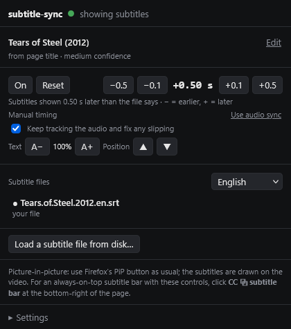

# subtitle-sync

A Firefox extension that puts automatic, audio-synced subtitles on videos on any website.

**[Install from Firefox Add-ons](https://addons.mozilla.org/en-US/firefox/addon/subtitle-sync/)** (not approved as of Nov 2026)




<sub>Screenshots use *Tears of Steel*, (CC) Blender Foundation | mango.blender.org, CC BY 3.0.</sub>

When you start a video on a website, the extension:

1. **Works out what's playing.** It reads the page title, structured page data (schema.org),
   the address and the video's file name, in every frame of the page, including embedded
   players from other sites. A TV episode only counts as identified when the season and
   episode numbers are stated, and different sources mustn't disagree. If it isn't sure, it
   loads nothing and asks you in the popup.
2. **Finds subtitles.** It searches [OpenSubtitles.com](https://www.opensubtitles.com). A result is only kept if the title,
   season and episode (or year) match and the language is yours. The rest are ranked by
   release name, downloads and trust, and machine translations come last.
3. **Checks the match.** The subtitles must roughly cover the video's length, which catches
   a wrong episode or a different cut. If one doesn't fit, the next one is tried. If none
   fit, nothing loads and the popup lists them with the reason each was skipped.
4. **Shows them** on the video as a standard subtitle track. That works on the page, in
   fullscreen, and in Firefox's own picture-in-picture window.
5. **Syncs them.** Where it's safe, it listens to the audio while you watch and lines the
   subtitles up with the speech. It locks on once the match is clear: in testing, after
   about 1–1½ minutes of steady dialogue, or 2–4 minutes in a film with lots of music and
   action. It never locks on to less than a minute of audio or fewer than 8 lines, and the
   popup shows how much it has heard so far. Then it keeps fine-tuning, and also catches
   jumps (ad breaks) and frame-rate drift.
6. **Remembers.** Downloaded subtitles, the chosen match and the timing are cached. Coming
   back to an episode costs no download and no re-syncing.

## Setup

1. Install the extension.
   - **For testing:** open `about:debugging#/runtime/this-firefox` → **Load Temporary
     Add-on…** → pick `firefox-extension\manifest.json`. It's removed when Firefox restarts.
   - **Permanently:** normal Firefox only keeps extensions signed by Mozilla. Signing is free
     and doesn't publish the extension ("unlisted"):
     1. Make a free account at https://addons.mozilla.org, then open
        https://addons.mozilla.org/developers/addon/api/key/, accept the agreement if asked, and
        click **Generate new credentials**. You get a **JWT issuer** and a **JWT secret**.
     2. In PowerShell, in this folder, paste each one when asked. `Read-Host` keeps them out of
        your command history, and they last only until you close that window:
        ```powershell
        $env:AMO_JWT_ISSUER = Read-Host "AMO JWT issuer"
        $env:AMO_JWT_SECRET = Read-Host "AMO JWT secret"
        python tools\sign_firefox.py
        ```
        This builds the zip, uploads it, and waits for Mozilla's checks and signature (usually
        minutes). It saves `dist\subtitle-sync-firefox-<version>-signed.xpi`. If the wait gets
        interrupted, run it again with `--download-existing`.
     3. Drag that `.xpi` into a Firefox window and choose **Add**. If a temporary copy is
        loaded, remove it from `about:debugging` first. A temporary copy's settings may not
        carry over, so check your API key in **Settings** afterwards.

     **Updating later:** raise `"version"` in `firefox-extension\manifest.json` (Mozilla never
     accepts the same version twice), run step 2 again, and drag in the new `.xpi`. It replaces
     the old one and keeps your settings, because the extension's id stays the same. Firefox
     won't update it by itself.

     `python tools\package_firefox.py` only builds the zip, without uploading. Don't zip the
     folder with PowerShell's `Compress-Archive`: on Windows PowerShell 5.1 it writes backslashes
     into the zip's paths, which Mozilla's rules don't allow.

     Firefox's install prompt will show the data this extension sends: page content (what the
     page says is playing, as a search on OpenSubtitles) and login details (your OpenSubtitles
     username and password, if you add them). Both go only to OpenSubtitles.
2. Get a free OpenSubtitles API key: the links are in the popup's **Settings**. Make an account at opensubtitles.com → **API consumers**
   → create a key. Paste it into the extension popup → **Settings**.
3. Optional: add your OpenSubtitles username and password. Logging in raises the daily
   download limit.

## Using it

Just play a video. The toolbar icon shows **CC** when subtitles are on, **?** when it needs
your confirmation, and **!** for a problem. The popup lets you:
- correct what's playing,
- pick another subtitle file,
- change the language,
- turn subtitles on or off,
- shift the timing (−0.5 / −0.1 / +0.1 / +0.5 s, or **Alt+Shift+G / Alt+Shift+H**).
  **−** shows the subtitles earlier, **+** later; the line under the buttons says where the
  timing stands (e.g. "Subtitles shown 0.50 s later than the file says"),
- **Reset** the timing: undoes your shifts and audio sync's, back to the subtitle file's own
  timing, and forgets the saved timing; audio sync then starts over,
- change text size and position,
- load a file from disk.

**Keep tracking the audio** (on by default, in the popup and Settings): after the first match it
keeps measuring where the subtitles belong, using the last 90 seconds of sound. A sudden jump (ad
break, cut scene) is corrected at once. A slow slip is followed in steps too small to see, and a
steady one becomes a new speed for the whole file. It can't fit each line to the speech as it
plays: a line has to show before its audio has played, so there's nothing to match it against yet.
It corrects from what it has just heard, for what comes next.

With tracking on, shifting by hand keeps tracking running, with your shift on top. With tracking
off, or where the audio can't be listened to, shifting by hand pauses audio sync for that video;
**Use audio sync** turns it back on.

**It stays on by itself.** Every couple of seconds it checks the subtitles are still showing: if
the player switched the track off or cleared it, or another video took over, it puts them back.
Your own **Off** stays off. A change of quality or server keeps the subtitles. If the player
switches added tracks off the moment they appear, the lines are drawn over the video instead and
the popup says so: Firefox's picture-in-picture can't show those, but the subtitle bar can.

**Ads before the show.** If the video is far too short for the subtitles (they run over 3× past its
end), the status says **waiting for the main video** and they load when it starts.

**Picture-in-picture**
- **Firefox's own PiP button:** the subtitles are drawn on the video inside the PiP window.
  This has been tested.
- **CC ⧉ subtitle bar** (top-right of the page when you move the mouse): opens a small
  always-on-top window that shows the current line. When you hover over it, it shows
  controls: on/off, timing, text size, position, language, and the next subtitle version.
  It also accepts G / H for timing. Use it alongside PiP when you want the controls, or on
  sites where Firefox's PiP shows the site's own captions.

## Limits (browser rules, not bugs)

- **A temporary add-on disappears when Firefox restarts.** If it's gone after a restart, that's why:
  load it again, or install the signed version (see Setup) so it stays.
- **A subtitle source needs a key.** No legitimate subtitle service offers downloads without
  a free API key. Free OpenSubtitles accounts also have a daily download limit. Cached
  subtitles don't count against it.
- **The subtitle bar needs a click in the main page.** Firefox only opens always-on-top
  windows in response to a click in the top-level page. A click inside an embedded player
  doesn't count (tested). The same click can't open both Firefox's video PiP and the bar,
  but both can be open together.
- **Audio sync only works where the browser allows listening.** That means videos from the
  same site, or streamed by the page itself (most modern players: HLS/DASH). It's
  automatically off, and the popup says why, for:
  - DRM-protected services (Netflix and similar);
  - video files loaded directly from another site without permission. If the extension
    analysed those, the sound would be muted.

  There you get the subtitle file's own timing and the manual controls.
- **How audio sync listens.** Firefox only lets a page analyse a video's sound by routing it
  through Web Audio. The sound still plays, and volume and mute still work (tested). But the
  routing stays in place for that video until the page reloads, and adds a few milliseconds
  of audio delay. Turn audio sync off in Settings to avoid it.
- **It may need one click on the video first.** Firefox only allows audio analysis after
  you've clicked something in the player's page. If a video autoplays, sync starts after
  your first click on it.
- **Sites with custom PiP handling.** On some big sites (YouTube, Netflix and others),
  Firefox's PiP window shows the site's own captions instead of added ones. Use the
  subtitle bar there. Inside Firefox's PiP window, text size is set by Firefox's own
  captions menu, not by the extension.
- **Players that draw onto a canvas** instead of a normal video element can't show added
  subtitles.

## Tests

The extension's tests run in real Firefox (headless) through Selenium:

```powershell
python -m venv .venv-test
.venv-test\Scripts\python -m pip install -r requirements-dev.txt
.venv-test\Scripts\python tests\firefox\make_media.py C:\temp\subsync-media   # test video (Windows TTS + ffmpeg)
.venv-test\Scripts\python tests\firefox\run_unit.py
.venv-test\Scripts\python tests\firefox\run_sync_eval.py
.venv-test\Scripts\python tests\firefox\run_e2e.py C:\temp\subsync-media
```

`run_sync_eval.py` (no setup needed) replays the sound of a real film, *Tears of Steel*
(music, effects, sparse dialogue), through the extension's own audio-sync code, starting at
51 different points with the subtitles off by −30 to +4 s. It fails if sync is ever more
than 0.3 s wrong, or locks on too rarely or too slowly. The film's loudness and subtitles
are in `tests/firefox/fixtures/tos.js` ((CC) Blender Foundation | mango.blender.org, CC BY 3.0).

`run_e2e.py` starts a fake streaming site with a cross-origin embedded player, a same-site
player and a stand-in OpenSubtitles API. It then checks:

- the automatic flow: identify → search → reject the wrong episode and a too-long file → load;
- caching;
- seeking, pause, 2× speed and fullscreen;
- Firefox's own PiP window (screenshot) and the subtitle bar;
- audio sync (must find a 2.3 s delay within 0.15 s);
- Reset (back to the file's timing, and the saved timing is forgotten);
- unclear pages (must ask, not guess);
- loading a file from disk.

## Project layout

```
firefox-extension/   the extension (no build step)
  background.js        the automatic flow (identify -> find -> check -> load -> remember)
  lib/                 identification, OpenSubtitles, ranking, subtitle parsing, cache
  content/             runs in pages: video + subtitle track, audio sync, the subtitle bar
tools/               package and sign for Firefox
tests/               packaging tests (pytest); tests/firefox/ = extension tests (Selenium)
```

## License

MIT: see [LICENSE](LICENSE). The *Tears of Steel* material in `tests/firefox/fixtures/` and `docs/screenshots/` stays under CC BY 3.0, (c) Blender Foundation | mango.blender.org.
